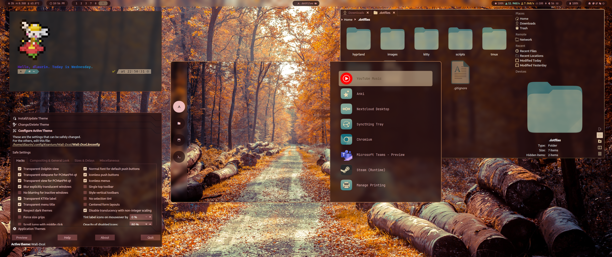
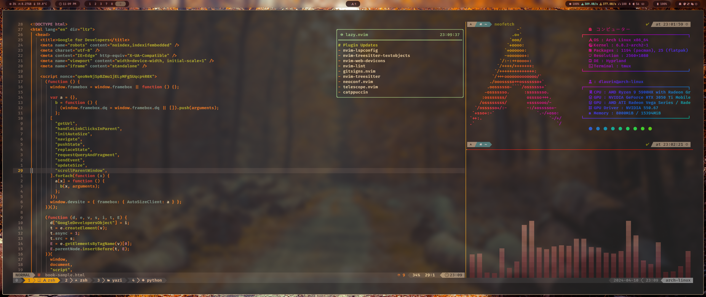

# .dotfiles

    
    &nbsp;&nbsp;&nbsp;&nbsp;&nbsp;&nbsp;&nbsp;&nbsp;
    
    &nbsp;&nbsp;&nbsp;&nbsp;&nbsp;&nbsp;&nbsp;&nbsp;
    

<h1 align="left">Hyprdots: <i><em>deluxe</em></i> edition</h1>

This project takes the hyprdots setup and adopting it to my more custom CLI workflow 

 

 

# Thank You hyprdots! ✨
- [prasanthrangan ](https://github.com/prasanthrangan) for this [hyprdots](https://github.com/prasanthrangan/hyprdots/tree/main)

